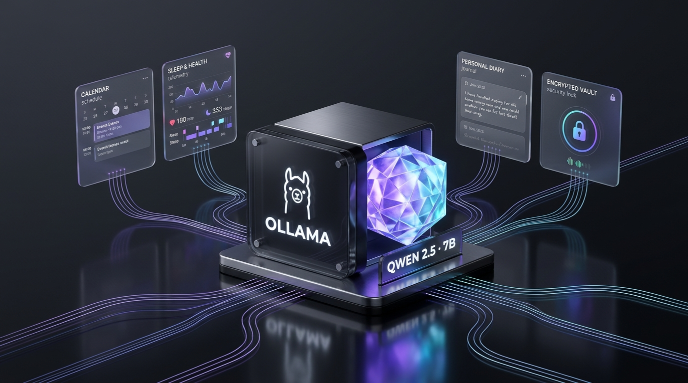

# Po Second Brain — Personal Life Ledger, Ollama Qwen 2.5 AI & Network Security Hub (`LAB_BasicNetwork`)

A full-stack personal **Second Brain**, **Apple Health & Calendar Dashboard**, **Encrypted Password & Diary Vault**, and **IP/Network Security Lab** built with zero external dependencies (Python 3 Standard Library + SQLite3 + Apple Human Interface Guidelines / Liquid Glass UI).



---

## Core Architecture & Three Course Pillars

### 1. Useful Functions & Second Brain AI
- **Overview Summary Dashboard**:
  - **3 Apple Health / Fitness Donut Ring Charts**: Sleep Recovery (`hrs` vs 8.0h goal), Daily Nutrition (`kcal` & `protein`), and Calendar Task Completion.
  - **Quick Second Brain Command Bar**: Natural-language scheduling and logging directly from the home screen.
  - **Ollama & Qwen 2.5 7B Showcase**: Detailed visual & technical presentation of the local LLM runtime.
- **Liquid Glass AI Model Selector (Multi-Engine Hybrid Router)**:
  - **Offline Local LLM (`Ollama` · `qwen2.5:7b`)**: Runs 100% offline on `http://127.0.0.1:11434/api/chat` (`7.61B` parameters, `Q4_K_M` 4.7 GB GGUF, `32,768` token context window, `30m` warm RAM keep-alive).
  - **Cloud Free-Tier APIs (For External Web Hosting)**: Supports **Groq (`Llama 3.3 70B Versatile`)**, **Google Gemini (`gemini-2.5-flash`)**, and **OpenRouter** when deployed to cloud servers.
  - **Built-in Deterministic Smart Engine**: Zero-dependency fallback for instant offline NLP scheduling and RAG queries.
  - **Full Action Agent (`[ACTION: {...}]`)**: Autonomously creates calendar events, writes diary reflections, logs sleep/nutrition metrics, and stores long-term memories in SQLite with **1-click Undo**.
- **Full-Page & Full-Screen Calendar**:
  - Full-width monthly calendar grid with tall day cells, `Expand Full Screen` mode, milestone checklist, and natural-language AI scheduling.
- **Apple Health Importer (Sleep & Nutrition)**:
  - Parses Apple Health `export.xml` (`HKCategoryTypeIdentifierSleepAnalysis`, `HKQuantityTypeIdentifierDietaryEnergyConsumed`, `HKQuantityTypeIdentifierDietaryProtein`), CSV, and JSON files.
  - Includes a live **iPhone Wi-Fi LAN Webhook** (`POST /api/health/webhook`) for 1-tap iOS Shortcuts automation.

### 2. IP & Network (`LAB_BasicNetwork`)
- **Live Network Telemetry**: Displays Client IP, Server Wi-Fi LAN IPv4, Hostname, Port, and active `ifconfig` network interfaces (`lo0`, `en0`, subnet masks).
- **ICMP Ping / TCP RTT & DNS Resolver**: Measures live DNS resolution latency and ICMP/TCP round-trip time to any hostname or IPv4 address.
- **IP Access Control List (ACL) & Subnet Firewall**: Supports CIDR rules (`127.0.0.1/32`, `192.168.0.0/16`, `10.0.0.0/8`, `203.0.113.0/24`) with an interactive packet simulator (`ALLOW` vs `BLOCK`).
- **Real-Time Security & Network Audit Log**: Records every authentication attempt, AI action, webhook sync, and network probe with client IP and timestamp.

### 3. Biometric & Cryptographic Security (On-Demand Vault Gate)
- **Selective Biometric Gate**: Overview, Calendar, Sleep & Nutrition, and Second Brain AI open immediately; authentication is required **only** when opening Protected Sections (**Diary Library**, **Password Vault**, **IP & Security**).
- **MacBook Air M2 Touch ID (`WebAuthn / FIDO2 Passkeys`)**: Hardware Secure Enclave passkey registration and verification via `navigator.credentials`.
- **192-D Sobel Edge & Facial Geometry Face ID**:
  - Captures a 4-frame burst from the central facial ROI and extracts **192 Z-score normalized features** (64 facial topography blocks, 64 horizontal/vertical Sobel landmark gradients, and 64 chromaticity/symmetry ratios).
  - Enforces a strict **85.0% zero-mean structural correlation + L1/L2 distance threshold** so unauthorized faces are rejected (`HTTP 401`), and locks out re-enrollment from the lock screen once an owner profile is registered.
- **AES-256-CTR Password Vault & Editorial Diary Library**:
  - Encrypts Personal & Game passwords at rest using `PBKDF2-HMAC-SHA256` (`100,000`–`120,000` iterations) + `HMAC-SHA256` CTR stream cipher with per-record random nonces and authentication tags.
  - Redacts all password ciphertexts from LLM RAG prompts.

---

## Quick Start

### 1. Run Locally (macOS / Linux / Windows)
```bash
python3 server.py
```
Then open **http://localhost:3000** in your browser.
- **Default Passcode for Protected Vaults**: `admin123`
- **Local Ollama Model (Optional)**:
  ```bash
  ollama pull qwen2.5:7b
  ollama serve
  ```

### 2. Project Structure
```text
LAB_BasicNetwork/
├── server.py                      # Zero-dependency Python 3 HTTP + API + RAG + Security server
├── README.md                      # Project documentation
└── public/
    ├── index.html                 # Apple HIG Liquid Glass & Bento workspace UI
    ├── styles.css                 # Adaptive Light/Dark design tokens & Liquid Glass surfaces
    ├── app.js                     # Frontend controller, 192-D Face ID mesh, WebAuthn & Donut charts
    └── ollama-qwen-showcase.jpg   # Ollama & Qwen 2.5 7B architecture visual
```
