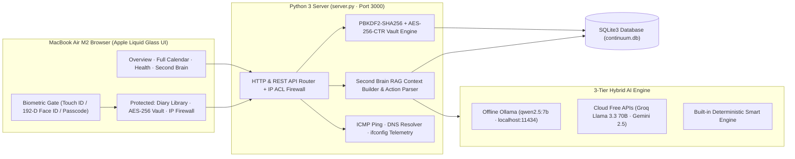
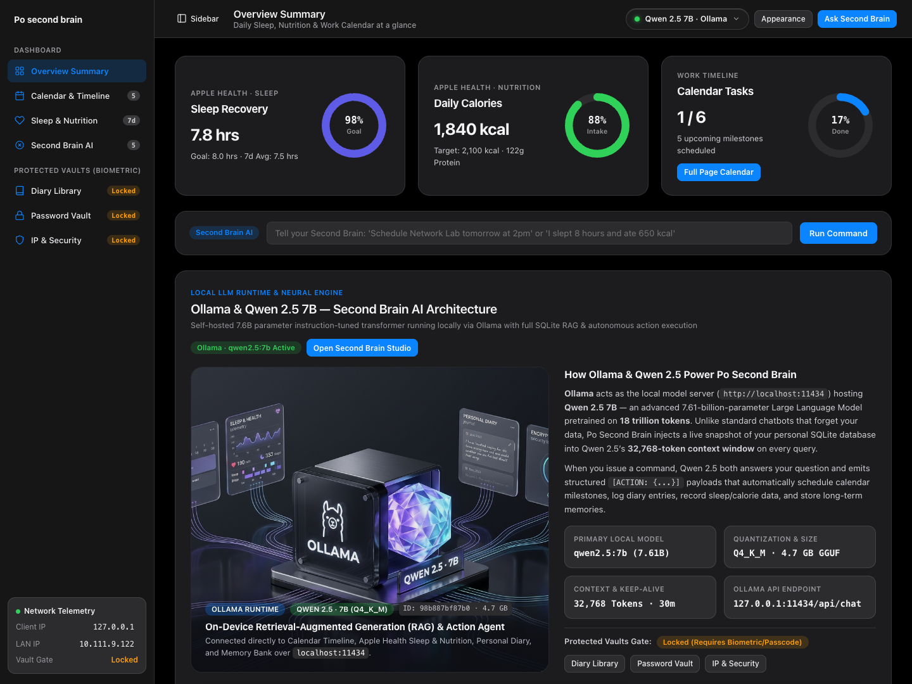
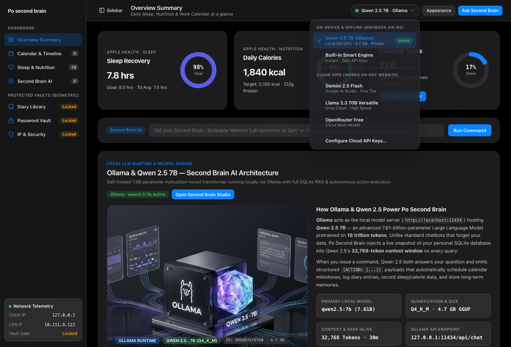
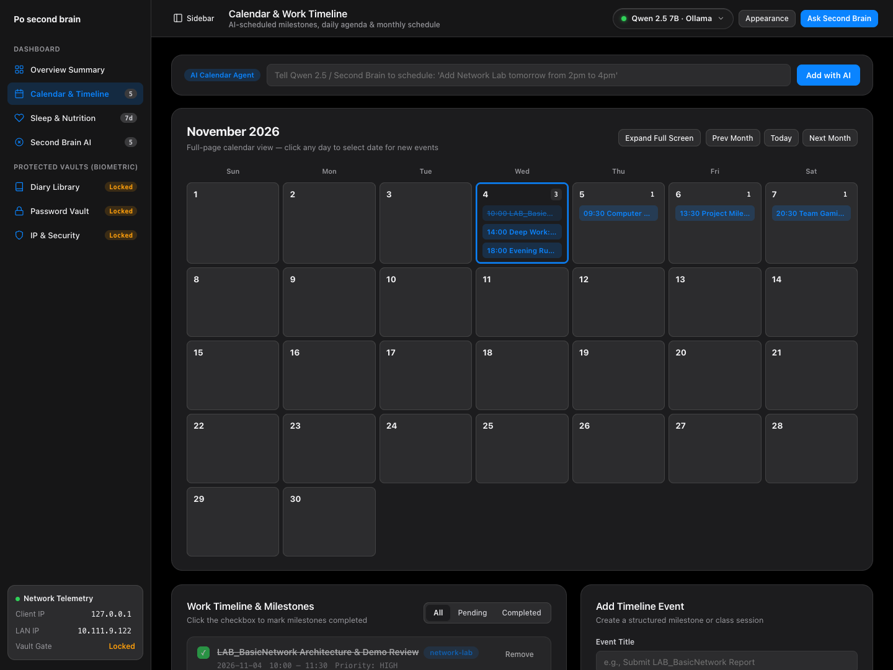
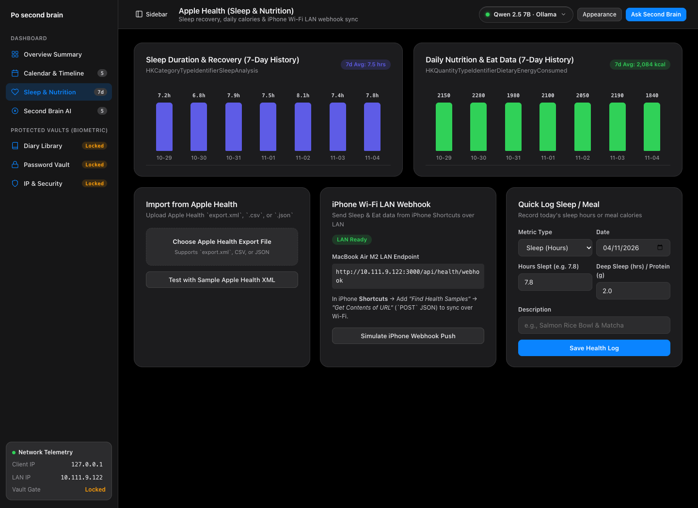
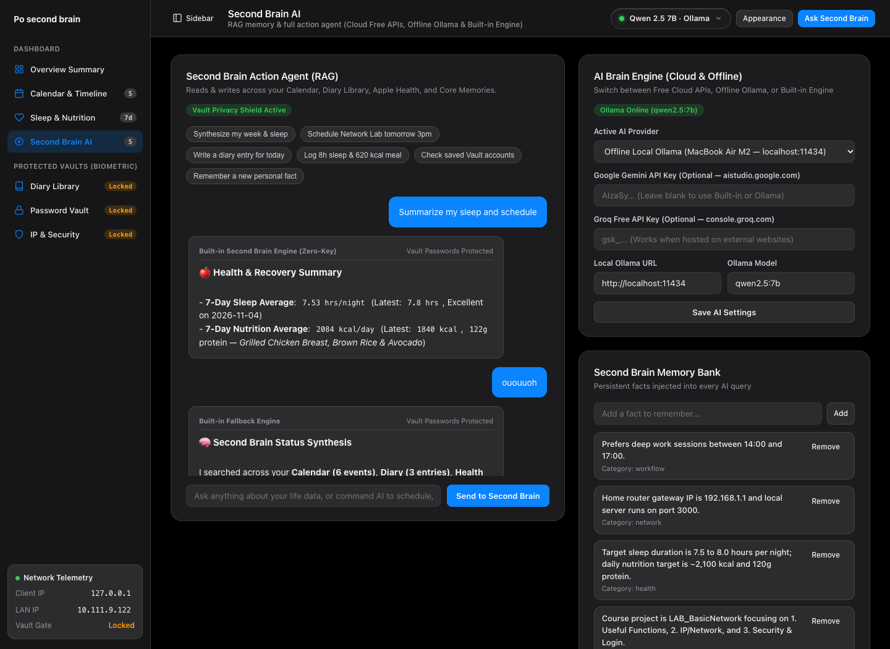
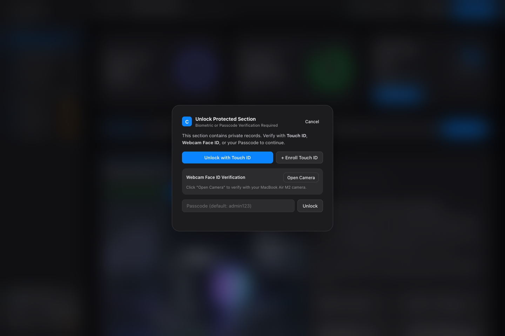
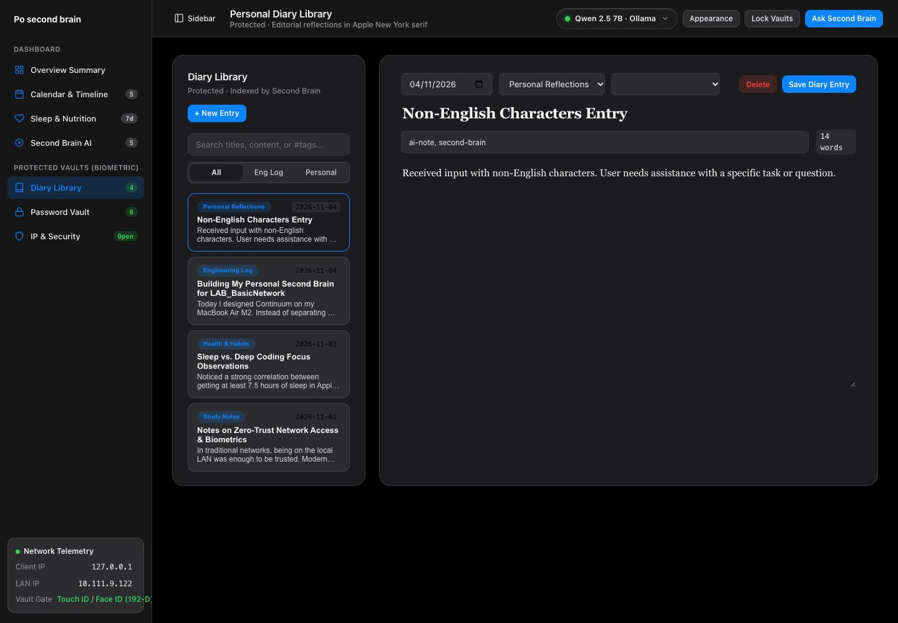
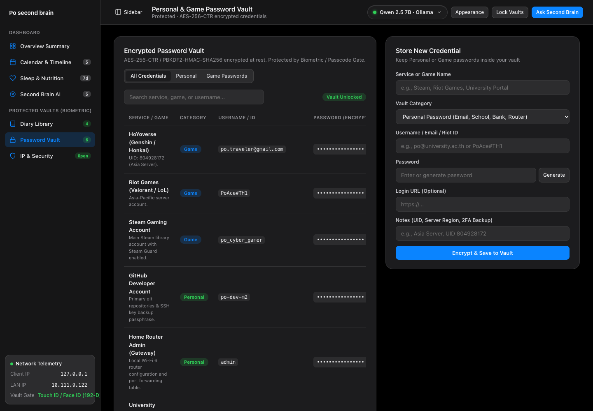
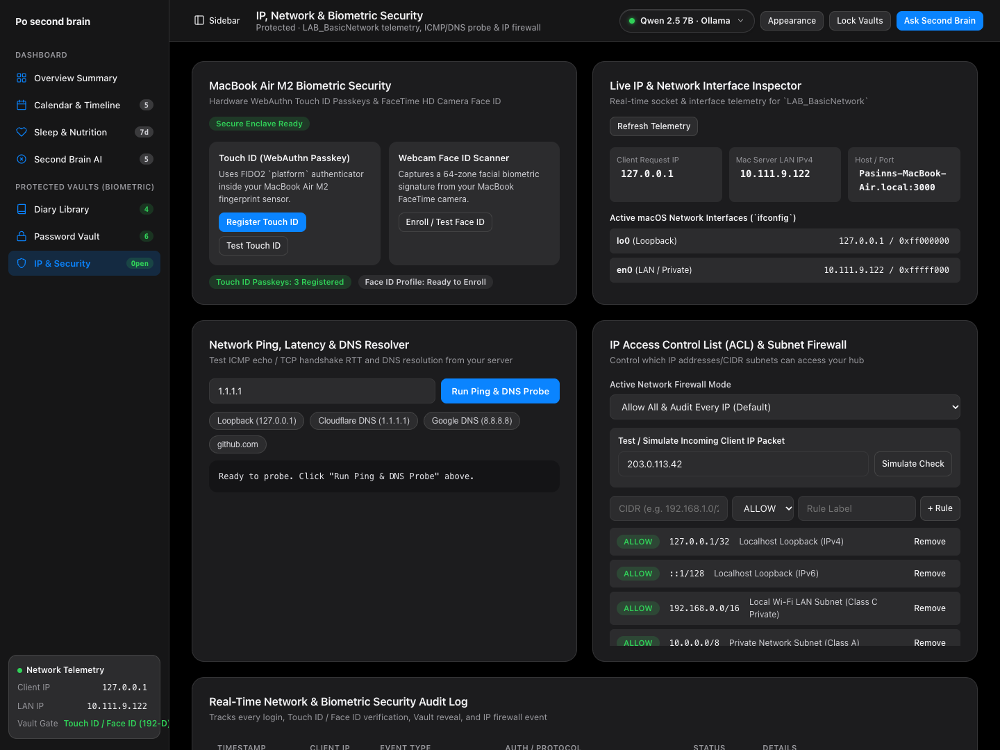

# User Manual & Technical Concept Guide: Po Second Brain (`LAB_BasicNetwork`)

| Field | Details |
| :--- | :--- |
| **Student Name** | **Pasinn Nitikornchairat** |
| **Student ID** | **67992023** |
| **Course / Lab** | `LAB_BasicNetwork` — Useful Functions, IP/Network & Biometric Security |
| **GitHub Repository** | [https://github.com/67992023-cmd/po-second-brain](https://github.com/67992023-cmd/po-second-brain) |
| **Local Mac URL (Touch ID, Face ID & Ollama)** | `http://localhost:3000` |
| **Local Wi-Fi LAN URL (iPhone Health Webhook)** | `http://10.111.9.122:3000` |

---

## 1. Core Concept & Project Vision

**Po Second Brain** is a personal **Life Ledger, Local AI Second Brain, and Network Security Hub** designed around three core engineering pillars required for the course lab:

1. **Pillar 1 — Useful Everyday Functions & Second Brain AI**:
   - Instead of scattering personal data across separate apps, **Po Second Brain** unifies **Work Calendar & Milestones**, **Apple Health (Sleep Recovery & Daily Calorie/Protein Intake)**, **Personal Diary Library**, and **Personal & Game Password Vault** into a single SQLite-backed system.
   - An integrated **Retrieval-Augmented Generation (RAG) & Autonomous Action Agent** powered locally by **Ollama (`qwen2.5:7b`)** (with 1-click failover to Cloud Free APIs such as **Groq Llama 3.3 70B**, **Google Gemini 2.5 Flash**, and **OpenRouter**) remembers everything in the database and executes real actions (`Schedule event...`, `Log diary...`, `Record sleep/calories...`, `Save memory...`) with 1-click **Undo**.
2. **Pillar 2 — IP & Network Engineering (`LAB_BasicNetwork`)**:
   - Provides real-time network telemetry (Client IP, Server Wi-Fi LAN IPv4, Hostname, Port, and `ifconfig` network interfaces), an interactive **ICMP Ping / TCP RTT & DNS Resolver**, a **CIDR Subnet Firewall & Packet Simulator**, and a live **Network & Security Audit Log**.
3. **Pillar 3 — Biometric & Cryptographic Security (On-Demand Vault Gate)**:
   - Uses an **On-Demand Security Gate**: daily productivity views (Overview, Calendar, Health, AI) open immediately without friction, while sensitive vaults (**Diary Library**, **Password Vault**, **IP & Security**) require **MacBook Air M2 Touch ID (WebAuthn Passkeys)**, **192-Dimensional Sobel Gradient Webcam Face ID**, or **PBKDF2-HMAC-SHA256 Passcode (`admin123`)**.



---

## 2. Screen-by-Screen User Manual & Feature Walkthrough

### 2.1 Overview Summary Dashboard (Entry Page)


- **Purpose**: Serves as the clean entry dashboard inspired by Apple Health and macOS Sequoia.
- **3 Apple Donut Ring Charts**:
  1. **Sleep Recovery (`hrs`)**: Displays last night's sleep duration (`7.8 hrs`, `98%` of the `8.0 hrs` recovery goal) and 7-day average.
  2. **Daily Calories (`kcal` & Protein)**: Displays daily energy intake (`1,840 kcal`, `88%` of `2,100 kcal` target) and protein grams (`122g`).
  3. **Calendar Tasks (`Done / Total`)**: Tracks completed vs. scheduled milestones with a 1-click **`Full Page Calendar`** button.
- **Quick Second Brain AI Command Bar**: Type natural commands such as *"Schedule Network Lab tomorrow at 2pm"* or *"I slept 8 hours and ate 650 kcal"* directly from the home page.
- **Ollama & Qwen 2.5 7B AI Model Showcase**: Presents the architecture, specifications (`7.61B` parameters, `Q4_K_M` 4.7 GB GGUF, `32,768` token context window), and data flow of the local LLM server running on `127.0.0.1:11434`.

---

### 2.2 Clean Liquid Glass AI Model Selector (Top Toolbar)


- **Purpose**: Allows instant 1-click switching between local offline AI models and cloud APIs.
- **Available Engines**:
  - **Local & Offline**:
    - **`Qwen 2.5 7B (Ollama)`**: Primary local LLM running via `/usr/local/bin/ollama` at `http://localhost:11434` with 100% local privacy.
    - **`Auto Hybrid Router`**: Uses local Ollama when on Mac, or automatically switches to Cloud APIs / Built-in Engine when hosted online.
    - **`Built-in Smart Engine`**: Zero-dependency local NLP parser for instant offline command execution.
  - **Cloud Free APIs (For External Web Hosting)**:
    - **`Google Gemini 2.5 Flash`**, **`Groq Llama 3.3 70B`**, and **`OpenRouter Free Models`**.

---

### 2.3 Full-Page Calendar & Work Timeline


- **Purpose**: Provides a full-width monthly calendar and milestone manager with AI natural-language scheduling.
- **How to Use**:
  1. **AI Calendar Agent Bar (Top)**: Type *"Add Network Lab presentation on Friday from 13:00 to 15:00"* and click **Add with AI**.
  2. **Full-Page Month Calendar**: Displays the entire month across 100% of the workspace width with up to 4 event chips per day cell. Click any date cell to select it.
  3. **Expand Full Screen Button**: Collapses the sidebar and bottom panels so the monthly calendar fills the entire screen.
  4. **Work Timeline Checklist (Bottom Left)**: Filter milestones by `All`, `Scheduled`, or `Completed`, check off finished tasks, or add events manually.

---

### 2.4 Apple Health (Sleep & Nutrition Telemetry + iPhone LAN Sync)


- **Purpose**: Tracks personal sleep recovery and nutrition metrics imported from Apple Health.
- **3 Ways to Import Data**:
  1. **Upload Apple Health File**: Import `export.xml` (`HKCategoryTypeIdentifierSleepAnalysis`, `HKQuantityTypeIdentifierDietaryEnergyConsumed`, `HKQuantityTypeIdentifierDietaryProtein`), `.csv`, or `.json` files, or click **Test Sample Apple XML Import**.
  2. **iPhone Shortcut Wi-Fi LAN Webhook**: Sends a `POST` request over local Wi-Fi (`http://10.111.9.122:3000/api/health/webhook`) from the iOS Shortcuts app to sync sleep and calories automatically.
  3. **Manual Log Form**: Log sleep hours, deep sleep, calories, and protein directly.

---

### 2.5 Second Brain AI Studio (RAG Memory & Autonomous Action Agent)


- **Purpose**: Interactive conversational AI studio with full access to your SQLite Second Brain context.
- **How RAG + Autonomous Actions Work**:
  - Every prompt automatically gathers upcoming Calendar events, recent Diary entries, 7-day Sleep & Calorie averages, Core Memories, and **privacy-redacted** Vault metadata (service names & usernames only — encrypted passwords are never sent to cloud LLMs).
  - When Qwen 2.5 / Second Brain executes an action (`add_event`, `add_diary`, `log_health`, `add_memory`), an **Action Receipt Chip** appears below the message with a 1-click **Undo** button to revert the database change.

---

### 2.6 On-Demand Biometric & Passcode Security Gate


- **Purpose**: Protects sensitive personal data while keeping everyday dashboard views fast and accessible.
- **3 Authentication Methods**:
  1. **MacBook Air M2 Touch ID (`WebAuthn / FIDO2 Passkey`)**: Uses the hardware Secure Enclave fingerprint sensor via `navigator.credentials.create()` and `navigator.credentials.get()`.
  2. **192-Dimensional Sobel Gradient Webcam Face ID**:
     - Captures a **4-frame burst** over 210ms from the central oval reticle (`32×48` facial ROI) and extracts **192 Z-score normalized biometric features**:
       - `64` Zero-Mean Facial Topography blocks (`(Y - mean) / std`)
       - `64` Horizontal & Vertical Sobel Edge Gradients (`Gx`, `Gy` across eyebrows, eye sockets, nose bridge, mouth, and jawline)
       - `64` Chromaticity & Left/Right Symmetry deltas (`R-G`, `B-Y`)
     - Enforces a strict **`85.0%` zero-mean Pearson structural correlation + L1/L2 distance threshold**: the enrolled owner passes (`~92%–99%`), while a friend's face is rejected (`HTTP 401 Unauthorized`).
     - **Lock Screen Re-Enrollment Guard**: Once the owner's 192-D face profile is enrolled, the `Enroll` button is hidden on the lock screen so another person cannot overwrite the owner's face.
  3. **Master Passcode (`PBKDF2-HMAC-SHA256`)**: Verified using `120,000` iterations of SHA-256 with a random 16-byte salt and constant-time `hmac.compare_digest` (Default demo passcode: **`admin123`**).

---

### 2.7 Protected Personal Diary Library


- **Purpose**: Distraction-free split-view notebook for personal reflections, network lab notes, and ideas.
- **Features**:
  - Styled in Apple's editorial **New York** serif typeface (`ui-serif, "New York", Georgia, serif`) with comfortable 68ch reading measure.
  - Filter entries by notebook (`Personal Reflections`, `Network Lab Notes`, `Second Brain Ideas`), search full-text tags/titles, and index new entries directly into the Second Brain RAG memory.

---

### 2.8 Protected Personal & Game Password Vault (`AES-256-CTR`)


- **Purpose**: Encrypted storage for both **Personal Accounts** (GitHub, Apple ID, University Portal) and **Game Accounts** (Steam, Riot Games, Hoyoverse).
- **Cryptographic Architecture**:
  - Passwords are encrypted at rest in SQLite (`enc:v1:...`) using a 256-bit key derived via `PBKDF2-HMAC-SHA256` (`100,000` iterations), a 16-byte random cryptographic nonce per entry, an `HMAC-SHA256` CTR keystream, and a 16-byte HMAC integrity tag.
  - Includes 1-click **Reveal / Hide**, **Copy Secret**, and a **20-character CSPRNG Password Generator** (`window.crypto.getRandomValues`).

---

### 2.9 Protected IP, Network & Subnet Firewall Lab (`LAB_BasicNetwork`)


- **Purpose**: Complete networking and security laboratory fulfilling the `LAB_BasicNetwork` course requirements.
- **Key Modules**:
  1. **Live Network Telemetry & `ifconfig` Interfaces**: Displays Client IP (`127.0.0.1`), Server Wi-Fi LAN IPv4 (`10.111.9.122`), Hostname/Port (`3000`), and active network interfaces (`lo0`, `en0`).
  2. **ICMP Ping / TCP Latency & DNS Resolver**: Resolves any hostname (`1.1.1.1`, `8.8.8.8`, `github.com`, `localhost`) to its IPv4 address, measures DNS lookup time in milliseconds, and executes an ICMP `ping` or TCP handshake RTT probe.
  3. **IP Access Control List (ACL) & CIDR Firewall Simulator**:
     - Supports three firewall modes (`Allow All & Log`, `Private LAN / Loopback Only`, `Strict Custom CIDR Rules`).
     - Test any simulated source IP (e.g. `192.168.1.42` -> `ALLOWED`, `203.0.113.50` -> `BLOCKED`) and add/delete custom CIDR subnet rules.
  4. **Real-Time Security & Network Audit Log**: Logs every login, failed face verification, AI query, webhook sync, and network diagnostic probe.

---

## 3. How to Run & Test (For Instructor Evaluation)

1. **Clone the Repository**:
   ```bash
   git clone https://github.com/67992023-cmd/po-second-brain.git
   cd po-second-brain
   ```
2. **Start the Server** (Zero `pip` or `npm` dependencies required — uses Python 3 standard library):
   ```bash
   python3 server.py
   ```
3. **Open in Browser**:
   - Navigate to **http://localhost:3000**
   - **Default Passcode for Protected Vaults**: `admin123`
4. **Optional — Run with Local Ollama (`qwen2.5:7b`)**:
   ```bash
   ollama pull qwen2.5:7b
   ollama serve
   ```
